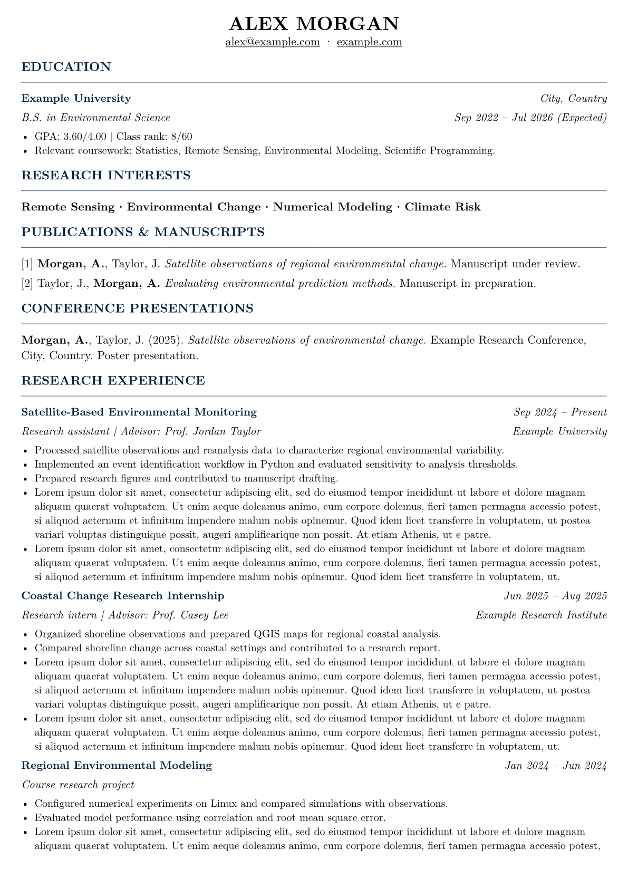

# Typst Academic CV Template

A compact academic CV with navy headings, horizontal rules, two-column entry headers, and reusable award and skills rows. All sample identities, affiliations, dates, and achievements are illustrative.



[Download the compiled PDF](assets/CV_en_template.pdf)

## Usage

Open `src/CV_template_en.typ` in Typst and replace the sample content below `#show: conf`. Set your contact information in `conf` or pass it through `#show: doc => conf(name: "YOUR NAME", email: "you@example.com", blog: "example.com", doc)`.

Compile locally:

```sh
typst compile src/CV_template_en.typ assets/CV_en_template.pdf
```

The template uses New Computer Modern and includes education, research interests, manuscripts, conference presentations, research experience, internships, awards, and skills. State publication status accurately.

## Customization

- `conf`: contact information, margins, font, spacing, and section headings. Supply `blog` without `https://`.
- `cv_block`: positional title plus optional `date`, `entity`, `location`, and `description` fields. Descriptions can continue across pages.
- `award_block`: positional title plus optional `entity` and `date` fields for compact rows.

Add or remove sections to suit your experience.
